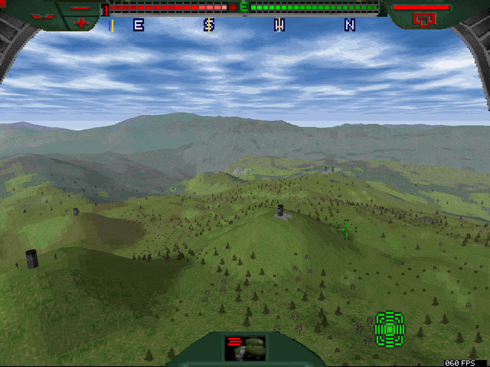
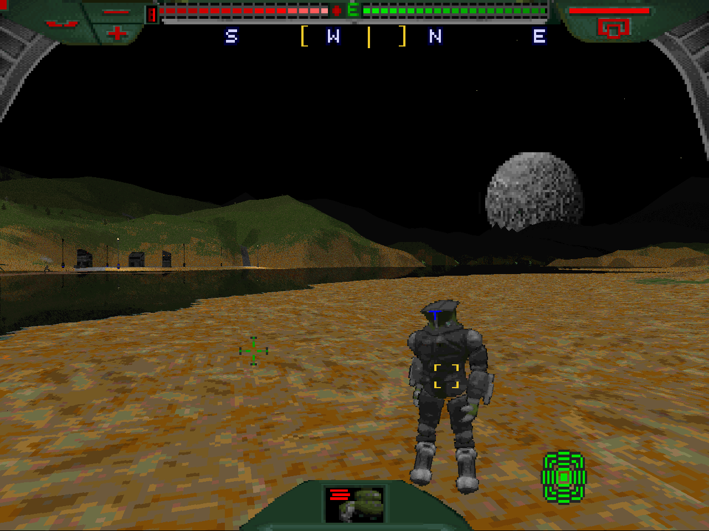

# Terra Nova: Strike Force Centauri with enhancements directly on Windows

This project lets you run Terra Nova: Strike Force Centauri's original game code without DOSBox via a native Windows support layer.
It renders at 1280×960 and targets 60 FPS, with optimized software rendering, gameplay, graphics and stability improvements, and new features.
The four demo missions are available under **Prequel** in the main menu.

This is a binary adaptation, not an engine remake or recovered original source.


[The TTLG forum thread](https://www.ttlg.com/forums/showthread.php?t=153557) where this project is mentioned (the TNova Plus announcement thread).

- [Screenshots](docs/screenshots/README.md)

- [Roadmap](ROADMAP.md): priorities and ideas for further work.
- [Changelog](CHANGELOG.md): notable additions, improvements and fixes by release.
- [Build guide](docs/building.md): supported inputs, dependencies, tests and packaging.
- [Source guide](docs/source-guide.md): where each feature lives and how the build works.
- [Backport address table](docs/address-map.csv): DOSBox/native locations; [reading and regenerating it](docs/source-guide.md#dosbox-and-native-address-mapping).
- [Patch catalogue](docs/patch-catalogue.md): feature groups and their dependencies.
- [Distribution contents](docs/distribution-audit.md): what each download includes and what comes from the player's originals.
- [Contributing](CONTRIBUTING.md): making and validating a change.
- [Credits](CREDITS.md): people, projects and tools behind the work.


## Playing

The game uses its original software renderer at a 1280×960 world view and the original higher-detail HUD/visor artwork shown by default.

Rendering targets 60 FPS; demanding scenes and slower hardware can still fall below it. Development and testing were deliberately carried out on an older dual-core Dell M4700 laptop, using the highest terrain quality setting.

The four demo missions open in the same game window and use Options shared with the retail campaign. These missions retain their original equipment and squad assignments and skip the retail campaign’s Quarters and outfitting screens.
In a paused Prequel mission, the **F5** and **F9** keys open save/load pickers.

Exact mission snapshots require a matching game build; restoring one reopens the game window. These are mainly intended for playtesting and troubleshooting.

Original weapon statistics and difficulty modifiers are preserved. AI changes retain the original pathfinder, scripted orders and mission restrictions.






## New Player options

| Option | Default | Effect |
| --- | --- | --- |
| Show FPS | Off | Displays completed world-frame rate. |
| Improved Target Selection | On | Uses precise selection and depth checks. Off restores the original rectangle-based choice, allowing units behind buildings to be selected when they appear in the target list. |
| Full-Rate AI Firing | Off | Allows more frequent weapon-readiness checks for both sides; retains cooldowns, costs, bursts and difficulty rules. |
| Wrist-Height Firing | On | Launches eligible player shots from animated arm hardpoints; off restores helmet-height origins. Nearby cover can block wrist shots. |
| Shot Aim Assist | On | With this enabled, unlocked shots may converge toward a nearby unit when the reticle overlaps it. Off keeps aiming along the reticle ray. Target lock is unaffected. |


## Setup and source

The player download is a portable setup ZIP. One-time setup for now needs 64-bit Windows CPython 3.12 and the supported retail/demo files and CD data. It downloads verified build tools into a separate folder, generates the adapted executable and edited resources locally, and creates a new installation.

Extract the ZIP and double-click **Setup.cmd**. Browse to the retail game, both demo folders and the retail CD ISO, then choose a new game folder and click **Set up game**. Keep Python's **Tcl/Tk** and **Python launcher** options enabled when installing Python. The setup window shows the current stage and offers a diagnostic log if something goes wrong. Command-line and offline setup remain available in the ZIP's README.

Setup shares unchanged assets where hard links are supported, so repeated installations use much less disk space. Saves, settings and generated files stay independent. Use `--data-mode copy` for independent resource copies; see [storage details](docs/building.md#installed-data-and-disk-space). Treat shared assets as read-only.

Your original installation stays intact. Afterwards, launch **Terra Nova Launcher.exe**; playing and saving snapshots need no installed Python or compiler. See the ZIP's README for the setup command and offline alternative.

The contributor download contains Python patch generators, readable x86 changes, a small C/assembly Windows bridge and collision helpers, launcher sources, tests and input/output manifests. Retained original routines, model geometry and edited artwork are derived from verified game files during setup. Neither download contains prepared game/resource deltas, complete game executables, original resource archives, generated model headers or saved-memory captures. Short binary-interface checks and displaced instructions remain in the patches; see the distribution account for the scope of the review.

Start with `build.py` for the complete current build and `test.py` for the contributor tests. There is one supported feature plan; the compatibility IDs inside snapshots are not selectable historical builds.


### Building from this repository

Run these commands in PowerShell from the repository folder. The examples below use
`C:\TNBuild`; change the paths to suit your machine. Install **Windows x64
CPython 3.12** and extract **Windows x86_64 Zig 0.15.2** to `C:\TNBuild\zig`.
Arrange your verified originals as described in the [build guide](docs/building.md):
`originals\TNOVA`, `originals\TNDEMO1`, `originals\TNDEMO2` and
`originals\_ISO\TNF108.ISO`.

Prepare the patch/test dependencies and the separate launcher environment:

```powershell
py -3.12 -m pip install --target C:\TNBuild\deps -r requirements-dev.txt
$env:PYTHONPATH = 'C:\TNBuild\deps'
py -3.12 -m venv C:\TNBuild\launcher-env
& C:\TNBuild\launcher-env\Scripts\python.exe -m pip install -r requirements-launcher.txt
```

Run the tests, then build the complete setup ZIP, including the launcher:

```powershell
py -3.12 -B test.py --retail-exe C:\TNBuild\originals\TNOVA\__FF.EXE
py -3.12 -B build.py --original-root C:\TNBuild\originals --compiler C:\TNBuild\zig\zig.exe --dependencies C:\TNBuild\deps --launcher-python C:\TNBuild\launcher-env\Scripts\python.exe --output C:\TNBuild\output
```

The output folder must not already exist. This builds and checks the package;
it does not install or start the game. To install it into a new folder:

```powershell
py -3.12 -B C:\TNBuild\output\package\install_portable.py --original C:\TNBuild\originals --destination C:\Games\TNovaNative --tools-cache C:\TNovaTools
```

Setup verifies the originals and generates the game locally. Add `--check-only`
to validate without installing. The [build guide](docs/building.md) covers offline
tools, separate original-file locations and narrower developer builds.


## Known limitations

Playtesting at the standard difficulty level has reached Mission 34. Testing does not yet cover every mission and difficulty combination.

Linux compatibility via Wine etc. has not yet been tested.

Known gameplay observations still under review include residual aim/reticle alignment, sprite and 3D model depth issues inherited from the original game, and squad collateral damage near friendly buildings.

This pre-release improves smoke visibility and collision and fixes the final laser segment changing direction on contact. See the [changelog](CHANGELOG.md) for changes since 0.1.0. [SMOKE, WEAPONS]

The new Full-Rate AI Firing feature/setting is optional; easier/harder difficulty balance needs more playtesting and may prove very hard against Hegemony Clones on the hardest settings.

Testing has primarily used this Windows 10 laptop. Another contributor has tested 0.1.0 on Windows 11; this pre-release still needs broader hardware testing and a complete clean-machine check.

Selected timing and gameplay routines have automated checks at rates from 20 to 120 updates per second. These checks do not establish that the entire game behaves correctly at every frame rate. Human gameplay at 120 FPS or higher has not yet been tested.

Mouse and keyboard remapping is not yet supported. The launcher only provides basic launch and snapshot controls; Terra Nova Plus has this covered already. See [roadmap](ROADMAP.md).

MIDI music, GPU rendering, anti-aliasing and resolution/draw-distance controls are not yet included.


## Licenses

Independently authored project code and documentation use the [MIT license](LICENSE). Original game material and third-party components retain their existing terms. The contributor download includes the [Keystone source archive](third_party/README.md) separately from the project's patches.


### AI Disclaimer:

This project was developed with GPT Astra in Codex, using Extra High/High reasoning effort. Considerable work went into keeping the code and documentation readable, with automated tests, manual playtesting and human review throughout.
Feedback and practical suggestions about this workflow are welcome.
